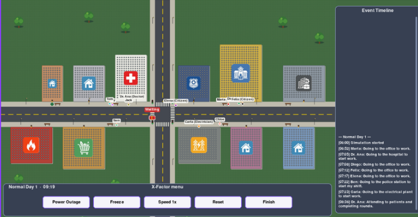

# Centuriatio: An Adapted Generative Agent Architecture for Urban Crisis Simulation
**Team Name:** f'(ai)

**Team Members:** Daniel Pool, V. L., Keyla Perez, Huy Ma, Brian Miller

## Overview 
**Centuriatio** is a real-time, agent-based simulation designed to study human behavior and social resilience during infrastructure failures.

While traditional urban simulations focus on the physics of infrastructure (e.g., power grids, traffic flow), Centuriatio focuses on the **social fabric**. Built on the foundations of the Stanford "Generative Agents: Interactive Simulacra of Human Behavior" paper (Park et al., 2023), this project populates a small village with two distinct populations:

1. **Generative Agents**: LLM-driven villagers who possess long-term memory, form relationships, hold turn-by-turn dialogue, and adapt their behavior during a simulated power outage.
2. **Scripted NPCs**: Background characters that follow **deterministic** logic (wandering between buildings or following specific agents) to populate the environment.
___
## Key Features

*    **Generative Agents:** The core AI villagers make autonomous decisions based on their environment, current crisis state, and a personal memory stream.
*    **Dual-Layer Memory System:** 
    *    *Episodic Memory:* Stores raw conversation transcripts and action histories for agents.
    *    *Semantic Memory:* Compresses daily events into nightly 3-sentence summaries.
*    **Turn-by-Turn Dialogue:** Agents autonomously initiate and conduct conversations when idle in the same building.
*    **Crisis Injection (X-Factor):** A manual trigger to simulate a village-wide power outage, forcing agents to adapt their routines (e.g., checking supplies, protecting medication).
*    **Automated Exit Interviews:** Upon clicking "Finish," the system generates emotional reflections and actionable lessons for every Generative Agent, exporting the entire simulation state to a structured JSON file for analysis.
*    **Day/Night Cycle:** The village transitions between daytime and nighttime, changing the environment and villagers' routines.
*    **Interactive Visual Environment:** A detailed village map featuring custom building designs, building icons, road markings, green grass, trees, streetlights, and benches.
*    **Crisis-Dependent Visuals:** Visual indicators, including exclamation marks during power outages, communicate important events happening throughout the simulation.
*    **Environmental Audio:** Daytime and nighttime background ambience, along with sound effects for power outages and power restoration.
*    **Customizable Settings:** Users can toggle the grid and building labels and adjust audio between High, Low, and Off.
---

## Visual Design & Environment

Centuriatio features a custom Pygame-rendered village environment designed to make the simulation more visually engaging and easier to understand.

*    **Village Environment:** Green grass, road markings, and map details create a more developed village setting.
*    **Custom Building Designs:** Buildings feature distinct colors, outlines, signs, and visual details to help identify their purpose.
*    **Building Icons:** Custom icons represent different building types throughout the village.
*    **Environmental Decorations:** Trees, streetlights, benches, and other decorative objects add detail to the environment.
*    **Crisis Indicators:** Visual alerts, including exclamation marks during power outages, communicate important events.
*    **Day/Night Appearance:** The environment changes throughout the simulation to reflect the current day/night cycle.

## Audio System

Centuriatio includes an environmental audio system that responds to the current state of the simulation.

*    **Daytime Ambience:** Background environmental audio that plays during the daytime.
*    **Nighttime Ambience:** Separate background ambience that plays during nighttime.
*    **Power Outage Sound:** A sound effect that plays when a power outage begins.
*    **Power Restoration Sound:** A sound effect that plays when electricity is restored.

Users can control audio through the Settings menu:

*    **High:** Normal audio volume.
*    **Low:** Reduced audio volume.
*    **Off:** Stops all background ambience and sound effects.

The system automatically switches between daytime and nighttime ambience as the simulation progresses. Audio playback also stops when the user finishes the simulation.

## Architecture & Adaptations

The Stanford paper *"Generative Agents: Interactive Simulacra of Human Behavior"* defines generative agents as computational software agents that simulate believable human behavior. This is achieved through an architecture that **stores**, **synthesizes**, and **applies** relevant memories to generate behavior using a large language model.

Centuriatio implements the same cognitive loop, while making specific architectural adaptations to the memory stream and retrieval mechanics to support structured analysis and optimized context-window usage.

### 1. Memory Storage & Synthesis (Stores & Synthesizes)

**The Original (Smallville):** 
Smallville uses a single, comprehensive memory stream. Every observation is added to one massive list. Periodically, the system reads recent memories to synthesize "Reflections," which are appended back into the same stream. 

**Centuriatio's Adaptation (Two-Tier System):**
We separated memory into two distinct tiers to prevent context bloat and to structure the data for export:
*    **Stores (Episodic Memory):** We maintain a record of raw conversation transcripts and an explicit `task_history` for every agent.
*    **Synthesizes (Semantic Memory):** At nightfall, the system compresses the day's raw events into a 3-sentence "Daily Summary." At the end of the simulation, it synthesizes the entire experience into an emotional reflection and actionable lessons.

### 2. Memory Retrieval (Applies)

When an agent needs to make a decision, the LLM cannot read the entire memory bank. The Stanford paper uses a mathematical formula to retrieve the most relevant memories: `Score = (Recency) + (Importance) + (Relevance)`.

**The Original (Smallville):**
Smallville normalizes all three variables using **Min-Max Scaling** to force them into a `[0.0, 1.0]` range. It calculates relevance using **Vector Embeddings (Cosine Similarity)**, checking the mathematical distance between the current context and past memories. It then applies equal weighting (`α = 1.0`) and feeds a fixed number of top memories to the LLM.

**Centuriatio's Adaptation:**
We adapted the retrieval formula while preserving the equal weighting (`α = 1.0`), but replaced the heavy mathematical components with lightweight heuristics:
*    **Min-Max Scaling (Removed):** Our formulas natively output values between `0.0` and `1.0`, making the normalization step mathematically redundant.
*    **Recency:** We replaced Smallville's real-time exponential decay with a fractional decay based on simulation days (Today = 1.0, Yesterday = 0.5, Two days ago = 0.33).
*    **Importance:** We replicated Smallville's approach; a background LLM call rates the criticality of an event from 1 to 10, which is mathematically normalized by dividing by 10.
*    **Relevance (Keyword Match):** We substituted cosine similarity with **Jaccard Similarity** and **NLTK WordNet Lemmatization**. Memories are scored by their lexical overlap with the current crisis context (e.g., matching lemmatized roots like "power", "outage", "hospital"). This avoids the overhead of vector embeddings while solving the synonym problem.
*    **Dynamic Selection:** Unlike a fixed Top-K retrieval, which always returns K memories, the system injects up to 5 memories that score `>= 1.0`. This prevents prompt dilution by ensuring the LLM only reads high-signal memories, even if it means reading fewer than 5.

### 3. System Architecture & Output

**Asynchronous Execution:**
Smallville uses a synchronous API architecture, where the simulation waits for the LLM to generate a response before advancing. Centuriatio uses an asynchronous `ThreadPoolExecutor`. Dialogue generation, importance rating, and nightly summaries are processed in background threads, allowing agents to continue moving and interacting independently of API latency.

**Output & Evaluation:**
Smallville evaluated agents via manual human observation and qualitative interviews. Centuriatio automates this evaluation. When the simulation concludes, the system triggers an "Exit Interview," prompting each agent to synthesize its memories into a final reflection. The entire state of the village (encounters, summaries, tasks, and reflections) is exported to a structured JSON file, allowing researchers to quantitatively analyze the social impact of a crisis.

---
## Installation & Setup
### 0. Navigator API Key
Generate API Key via Navigator

 - [Link to Navigator](https://navigator.ai.ufl.edu/ai-services/navigator-ai-toolkit/)
### 1. Clone Repository and Installing Requirements
Open your terminal and run:

1. Clone Repository
```bash
git clone https://github.com/Daniel-Pool-Engineer/Centuriatio.git
cd Centuriatio
```
2. Set Up a Virtual Environment
```bash
python -m venv .venv
.venv\Scripts\activate
```
3. Install Dependencies
```bash
pip install -r requirements.txt
```

### 2. Environment Variables

Create a `.env` file in the root directory and add your LLM API credentials:

```env
LLM_REST_URL=https://api.ai.it.ufl.edu/v1/chat/completions
LLM_API_KEY=sk-your-api
MODEL_NAME=nemotron-3-super-120b-a12b
SYNTHESIS_MODEL_NAME=nemotron-3-super-120b-a12b
```
### 3. NLTK Data
The first time you run the simulation, the code will automatically download the required NLTK `wordnet` corpus in the background. *(This only happens once, so the first launch may take an extra second while it downloads.)*

---

## How to Run & Demo Guide

Start the simulation from the root directory:

```bash
python -m frontend.ui.window
```
### The Demo Flow:
1.  **Start:** Click **"Start Simulation"** from the main menu.
2.  **Explore:** Watch villagers move around the map and observe the updated village visuals, including custom buildings, icons, roads, trees, streetlights, and benches.
3.  **Observe:** If two Generative Agents are idle in the same building, they will strike up a conversation. The "Event Timeline" on the right will log their actions.
4.  **Day/Night Cycle:** Let the simulation progress to see the environment change and hear the corresponding daytime or nighttime ambience.
5.  **Inject Crisis:** Click **"Power Outage"** in the bottom menu. The screen will dim, crisis indicators will appear, and agents will begin adapting their behavior. A power outage sound effect will also play.
6.  **Recovery:** Allow the recovery process to take place. When power is restored, the restoration sound effect will play.
7.  **Settings:** You can open the Settings menu to toggle the grid and building labels or cycle through High, Low, and Off audio settings.
8.  **Finish & Export:** Click **"Finish"**. Audio playback stops, and a progress screen appears as the system generates exit interviews for all Generative Agents.
9.  **Analyze:** The simulation saves and opens a `simulation_TIMESTAMP.json` file in the `exports/` folder. This file contains encounters, daily summaries, final reflections, and lessons learned for every AI agent.

---

## Project Structure
*    `backend/agent/`: Contains the LLM prompts, agent logic, role profiles, and day/night clock.
*    `backend/map/`: Pathfinding graphs, vehicle routing, and the static map data.
*    `backend/simulation_state.py`: Core dataclasses (Villager, FireTruck, MemoryEntry).
*    `backend/simulation_manager.py`: Coordinates movement, physics, scripted NPC behavior, and memory retrieval.
*    `backend/social_system.py`: Manages background LLM conversations and JSON exports.
*    `frontend/ui/`: Pygame rendering, menus, and the main application loop.
*    `frontend/village/`: Logics for the village.
*    `frontend/assets/`: Holds sprite and audio.
*    `exports/`: Output folder for generated JSON reports.

---
## Literature Reference

> Park, J. S., O'Brien, J. C., Cai, C. J., Morris, M. R., Liang, P., & Bernstein, M. S. (2023). Generative Agents: Interactive Simulacra of Human Behavior. *Proceedings of the 36th Annual ACM Symposium on User Interface Software and Technology*. https://doi.org/10.1145/3586183.3606763

